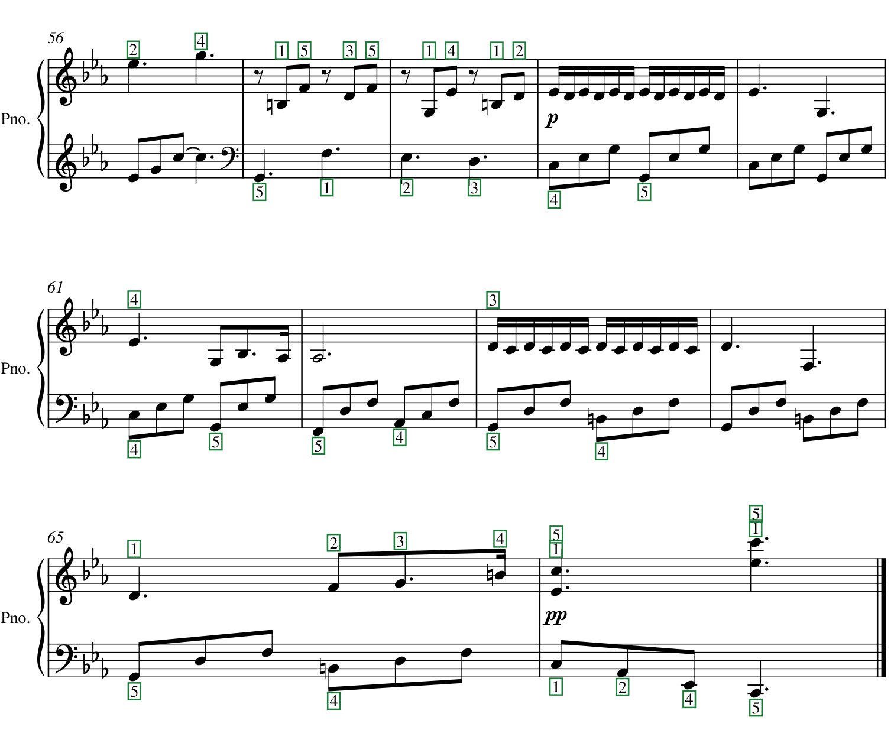

# PageMarks public fingering set

A test set and scorer for reading printed piano fingering from full score pages. A system reads each page into MusicXML
or `**kern`; the scorer aligns the pages with the truth and reports notes F1 and fingering recall and precision.

PageMarks is a model that reads notes and printed marks from full piano score pages. The model is not released; this is
its public fingering test set.



The last bars of `public-QmT4D7BniXE3`, every printed fingering digit boxed. PageMarks reads all 159 digits of this
piece and adds none.

## Contents

- `public-set/`: 12 piano pieces from [PDMX](https://github.com/pnlong/PDMX) (Public Domain MusicXML) with printed
  fingering, 48 pages and 893 digits. `pdf/` holds the MuseScore 4.7.5 renderings, `musicxml/` the truths,
  `pairs.jsonl` the piece ids, and `public_fingering_set.json` the selection rule and each piece's PDMX metadata. No
  piece, nor any PDMX score of the same song, is in PageMarks training data; the pieces are public and other systems
  may have seen them.
- `pagemarks/`: the scorer. Python 3.9 or later, no dependencies.
- `smb-subset/pages.jsonl`: 101 pages of the [Sheet Music Benchmark](https://huggingface.co/datasets/PRAIG/SMB), used to
  compare notes on published scores.
- `frontier/`: the prompt and protocol for the frontier models.

## Install

```
git clone https://github.com/justinliuforever/pagemarks
cd pagemarks
pip install -e .
```

The install is editable because the scorer reads the truths from the clone. It needs pip 21.3 or later.

## Input

One folder per piece, one file per PDF page:

```
READINGS/
  public-QmcUNxLQYYzj/p001.musicxml
  public-QmcUNxLQYYzj/p002.musicxml
  public-QmNcQTkXu3ih/p001.musicxml
  ...
```

- Folder names are the `id`s in `public-set/pairs.jsonl`: `public-` and the first 12 characters of the PDF's name.
- Pages are `p001`, `p002`, … in PDF page order, as `.musicxml`, `.xml`, `.mxl` or `.krn`. A missing page, or one that
  does not parse, counts as empty. Every system in the results read the pages as 300 dpi PNGs (`frontier/protocol.md`).
- Fingering is read from `<fingering>` in MusicXML, or from a lone digit 1–5 in a `<words>` direction, given to the
  first note on its staff at its onset. In `**kern` it is read from a `**fing` spine or a digit after a slash on a note
  (`4c/1`).
- Each line of `pairs.jsonl` gives `id`, `pdf`, `musicxml` (the truth) and `marks`, the piece's fingering digits.
- In `public_fingering_set.json`, `pdmx` is the path inside the PDMX release, `song` and `composer` are PDMX's metadata
  as published, `bars` and `of_bars` the bars kept and in the full score, `music_pages` the pages with staves, and
  `refused` the two scores whose fingering elements hold other numbers.

## Scoring

```
pagemarks-score READINGS
```

```python
from pagemarks import score

result = score("READINGS")
print(result["recall"], result["precision"])
```

`python3 -m pagemarks READINGS` runs the same from the repository root without installing.

A note matches on onset and pitch within aligned bars; a digit matches when the same digit sits on the aligned chord.
Each line gives a piece's pages read, notes F1, and digits matched, in the truth and read. The last line gives the notes
F1 mean over pieces, and fingering recall and precision pooled over all digits, with 95% bootstrap intervals over
pieces (10,000 draws, seed 0).

The truths score 1.000 throughout:

```
python3 -c 'import json, pathlib, shutil
for p in map(json.loads, open("public-set/pairs.jsonl")):
    folder = pathlib.Path("READINGS", p["id"]); folder.mkdir(parents=True, exist_ok=True)
    shutil.copy(pathlib.Path("public-set", p["musicxml"]), folder / "p001.musicxml")'
pagemarks-score READINGS
```

The truths also hold printed pedal marks, dynamics and hairpins. `pagemarks-compare TRUTH PAGE...` reports all of them
for one piece.

## SMB subset

`smb-subset/pages.jsonl` lists the pages; the pages and their `**kern` truths are in SMB. `score` is SMB's page name and
the stable key, `smb_id` SMB's id, `smb_row` the 0-based row of the test split as read in September 2026, and `texture`
SMB's texture.

To score notes on these pages, save each truth as a `.krn` file and write a pairs file with one line per page, such as
`{"id": "smb-00071", "musicxml": "kern/beethoven_sonata11_1_p3.krn"}`, paths relative to the pairs file. Run
`pagemarks-score READINGS --pairs FILE`; only notes F1 applies.

## Results

Fingering on the public set, pooled over the 12 pieces, with 95% intervals.

| System | Setting | Recall | Precision |
|---|---|---|---|
| PageMarks | — | 0.948 [0.885, 0.988] | 0.970 [0.942, 0.989] |
| GPT-6 Astra | `reasoning_effort: high` | 0.981 [0.943, 1.000] | 0.988 [0.972, 1.000] |
| Claude Opus 5.5 | adaptive thinking, `effort: high` | 0.953 [0.880, 0.992] | 0.956 [0.888, 0.992] |
| GPT-6 Sol | `reasoning_effort: high` | 0.901 [0.751, 0.976] | 0.948 [0.844, 0.991] |
| Audiveris 5.11 | fingering recognition on | 0.642 | 0.915 |
| Grok 4.6 | `reasoning_effort: high` | 0.561 [0.428, 0.685] | 0.581 [0.456, 0.691] |

The frontier models ran on 23–24 September 2026 as `frontier/protocol.md` describes. The Audiveris readings were not
kept, so its row has no interval.

## Reporting results

Score all 48 pages. Quote pooled fingering recall and precision with the intervals `pagemarks-score` prints, the notes
F1 mean, and the system's settings.

Questions and problems go to the issue tracker.
